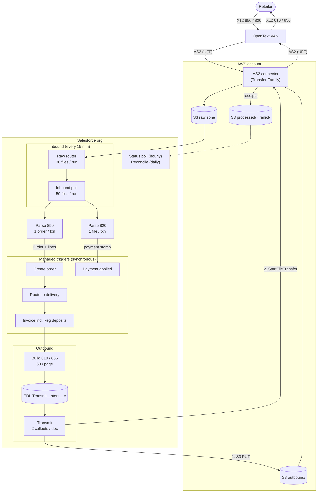

# Overview
Exchanges EDI documents between Gulf and its chain retailers (Walmart, Publix, etc.) through OpenText, the retailers' required VAN. Inbound purchase orders become Ohanafy orders. Invoices and ship notices go back out. Remittances come in and are applied as payments.
- Repo: `OHFY-EDI-OpenText`, which depends on `OHFY-Integration-Shared`. Moved off Tray onto Apex; TBM has been live on it since 08-06.
- Gulf: deployed to gulf-prod in **shadow mode** since 08-25. It polls `gulf-inbound/` every 15 min and transmits nothing.
- Criticality: highest. Chains are Gulf's biggest accounts and order through EDI.
## Documents
- **In:** 850 PO → order. 820 remittance → payment.
- **Out:** 810 invoice, 856 ASN (Walmart only at TBM).
- **Gulf difference:** Gulf is a DSD shop. Its dominant pair is 875 in / 894 out (894s are 95% Publix). 875 and 812 make up 23% of traffic and have no UFF code or Apex support yet. 812s arrive by email, not as files.
## Terms
- **AS2:** the secure transport protocol the documents travel over.
- **EDI:** Electronic Data Interchange. Business documents (POs, invoices, ship notices, payments) sent directly between trading partners' systems in a standard format, without paper, email, or rekeying.
- **VAN:** value-added network, the middleman that routes documents between trading partners. For the majority of our customers, that will be OpenText.
- **UFF:** OpenText's flat-file format. OpenText translates X12 to and from UFF, so our code only handles UFF. A document type needs a UFF mapping before we can support it.
- **X12:** the North American EDI standard. Each document type (transaction set) has a 3-digit number.
	- 810 - invoice
	- 812 - credit/debit adjustment
	- 820 - remittance advice
	- 850 - purchase order
	- 856 - advance ship notice (ASN) 
	- 861 - receiving advice
	- 875 - grocery PO
	- 894 - DSD delivery/return
## Open Items
- Retailer EDI IDs mapped on 0 of 444 chain accounts. Without them the shadow can watch but not route.
- Target was live Oct 15 (build 10/7, Full sandbox 10/8, parity 10/13, cutover 10/14). Confirm whether it held.
- Tickets: BMS-8322 (Gulf kickoff), BMS-7394 (capacity board)
# Architecture
Every leg is a Schedulable that fires a `Database.Batchable`, committing one page per fire. There are no Queueables (BMS-7509). AWS handles transport only (S3 + AS2 connector), because Apex can't speak AS2.

## Cadence
- Raw router and inbound poll: every 15 min (96 runs/day each)
- 810 build/transmit: every 15 min, 50 per fire
- 856 transmit: only 03:00–06:00 ET (retailer requirement), 50 per fire
- Transfer status poll: hourly. Receipt reconcile: daily.
- 15-min crons need 4 scheduled jobs each. EDI uses 24 of the org's 100 scheduled-job slots.
# Load Testing
## SObjects
Listed below as built for TBM (Core data model). Gulf runs the Split data model and has no `ohfy__Order__c`, so the Gulf equivalents and their triggers need confirming (see BMS-7132 in [[VIP SRS Out]] and [[Fintech (FTP)]]).
- `ohfy__Order__c`: EDI fields `EDI_Order_number__c`, `EDI_810_*` / `EDI_856_*` (Status, Sent, Failed, Skipped, Last_Sent_Date, AS2_Transfer_id)
- `ohfy__Order_Item__c`: 850 lines, upserted in later chunk transactions
- `EDI_Transmit_Intent__c`: staging for outbound 810/856
- `Integration_Config__c`, `Integration_Run_Stats__c`, `Watermark__c`: config, a dated run ledger, cursors
- Indirect: Delivery (routing), Invoice (from lines), Account / Item (UPC and retailer ID matching)
## Triggers (managed, synchronous, all flagged as open risk)
- **Create order:** Order afterInsert cascade (routing, pricing, roll-ups). 15 SOQL / 4 DML per 200 orders.
- **Route to delivery:** `TA_Order_BU_DeliveryAssociator` (before-update, wired via `Trigger_Action__mdt`). BMS-7015 / BMS-7388.
- **Invoice incl. keg deposits:** on line insert. 8 SOQL / 3 DML per 200 lines. The ceiling is about 12 chunks in one DML.
- **Payment applied:** before/after update on the payment stamp. Low risk.
## Known Limits
- **850 parse:** managed-package SOQL that `Limits.*` can't see. 16 orders in one transaction hit SOQL 201, so it runs **1 order per transaction** (interim since 09-02). An 18-order file takes about 20 chained hops.
- **810 transmit:** 2 callouts per doc against the 100-callout limit. A 53-order backlog threw "Too many callouts: 101".
- **Head-of-line blocking:** the unsent-orders query has no cursor, so about 50 stuck orders would block everything behind them.
- **Org-wide:** 500k daily async executions (31% used at TBM), and 22 free scheduled-job slots are shared with other integrations.
- Overlaps with the [[Stress Testing]] concerns: record locking on Order and Delivery during the 03–06 ET window, and catch-up bursts after an outage.
## Baseline (TBM prod, not Gulf)
- About 20 EDI orders/day (max 38), 524–588/month. Every leg runs under 5% of its daily capacity.
- Gulf's volume and document mix differ (DSD, 875/894). Build Gulf's numbers from its 90-day traffic file.
- Test harness: `EdiEndToEndTest` (raw file → order → 810 → 820 → payment) and `ohfy-tray/bin/run-capacity-tests.sh <org>`
- Board: https://claude.ai/code/artifact/c794de41-f59c-4f46-b472-464dc0470a13
