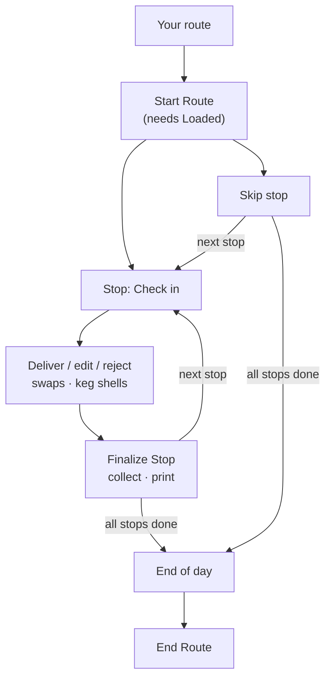

# Overview
The delivery driver's route day on iPhone, fully workable offline. Part of [[Mobile Offline]]. Accurate as of `release/v1.1.0`.

Status key: ✅ done · 🟡 partial · ⚪ built, not verified live/on hardware.
# Day Flow

## 1. Start of Day
- **Your route:** stops in order. Before check-in, each stop shows today's delivery.
- ✅ **Start Route** requires the truck to be Loaded. It stamps GPS and time and sets the delivery to Out For Delivery.
- ⚪ **Print all invoices:** prints every route invoice in stop order on the Zebra printer, or exports them as one PDF.
## 2. At Each Stop
- 🟡 **Order is enforced:** only the next stop can be checked in or skipped, and only after Start Route. To go out of order, skip the stops ahead.
- **Directions / Call:** hands off to Apple Maps or the phone.
- **Skip / reinstate:** a stop can be skipped with a reason code, and reinstated.
- 🟡 **Edit invoice:** adjust lines while the invoice is Loaded or Out For Delivery.
- 🟡 **Reject invoice:** pick a reason and add notes; the invoice drops out of collection and printing.
- 🟡 **Close out swaps:** finish the rep's swap ("Add to truck as" broken/non-sellable or refused/resellable). This replaces the invoice line and marks the swap Fulfilled.
- ✅ **Keg shells picked up:** returns the deposit, and the word "credit" never appears (BMS-9504). ⚪ Not verified live.
## 3. Finalize Stop
- ✅ The amount due pre-fills.
- ✅ A full collection writes a proof-of-delivery receipt with the payment method and the check or money-order number. COD checks and money orders are validated against the invoice amount.
- ✅ The app handles multiple invoices per stop, and multiple receipts per invoice over time.
- ✅ **Account credits:** credits already posted show on the invoice. Remaining account credit can be applied, capped at the amount due.
- **Short pay:** a reason is required. It is recorded and **never blocks** finalizing; holds are out of scope (G5).
- ⚪ **Print:** prints the invoice on the Zebra route printer with no network needed. It has never run on real hardware.
## 4. End of Day
- 🟡 **End of day summary:** collections by payment method plus open items. It's offered once every stop is delivered or skipped. This is a client-side summary, not the back-office route recon.
- **End Route:** sets the delivery to Delivered. It stays disabled while any invoice is neither Delivered nor Cancelled (e.g. skipped or short-paid stops), until the office resolves them.
# Not in V1
- Sell from truck (G13, fast follow).
- Short-pay approval holds (G5).
