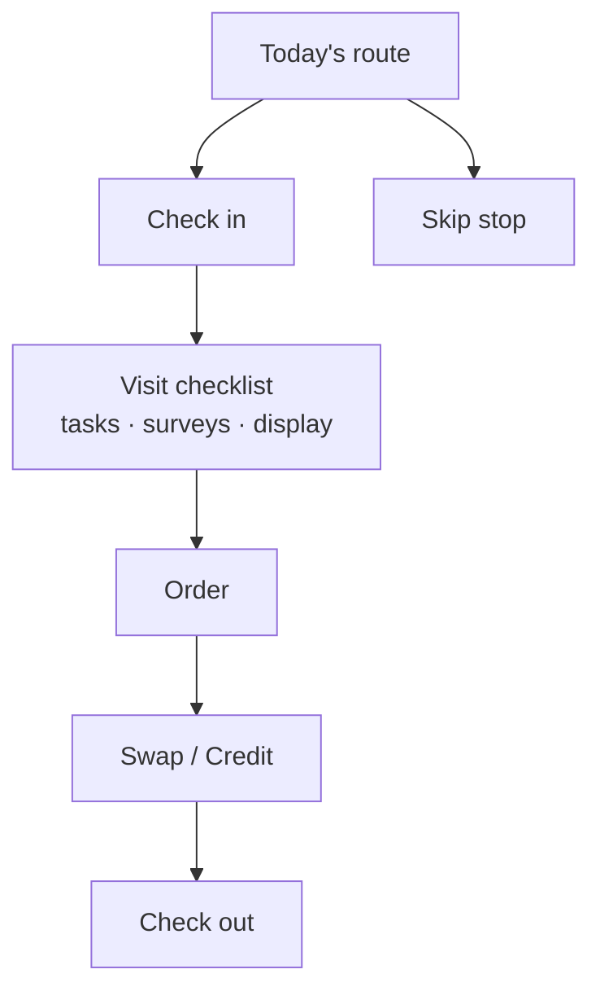

# Overview
The sales rep's route day on iPad, fully workable offline. Part of [[Mobile Offline]]. Accurate as of `release/v1.1.0`.

Status key: ✅ done · 🟡 partial · ⚪ built, not verified live.
# Day Flow

## 1. Start of Day
- ✅ Sign in; the first login pulls everything, and later days pull only changes.
- ✅ The **Today** screen lists stops in route order, shows the next stop's single action (Check in), and shows sync status.
- 🟡 **Data scope:** routes from yesterday to two days out, their accounts (including stops at accounts outside the rep's book), open invoices, catalog, price lists, promotions, and inventory. Account Team accounts depend on permission sets (Q78).
- 🟡 **Add stop:** add any account to today's route at a chosen position. Search covers cached accounts, plus a live Salesforce search when online. The new stop is workable before it syncs (BMS-9361, Q71).
## 2. Arrive and Check In
- ✅ Manual check-in stamps the GPS fix and time, and writes a visit plus the stop's start time and location.
- 🟡 **150 m geofence:** the app offers check-in on arrival and never checks in silently. It works only while the app is in the foreground.
- ✅ **Skip stop:** skip with a reason code; the stop counts as finalized.
- ✅ A duplicate check-in on the same day resolves to the existing visit.
## 3. Visit Checklist
Shown after check-in, in this order. An incomplete checklist opens the order **read-only** and doesn't block the visit.
- ⚪ **Tasks:** complete with notes, or defer with a reason and a new date.
- ✅ **Surveys:** every question must be answered; photos where required.
- 🟡 **Display check:** confirm an existing display, or build a new one. Either way, attach photos or video. Building a display auto-creates its Display Run.
## 4. Order
- 🟡 **Header:** delivery date (required), PO number, special instructions, and Dock sale / Off-day toggles.
- ✅ **Priority families:** Gaps/Voids, Mandates, MBOs, Promotions, each with open counts and targets.
- 🟡 **Product details per line:** why it was flagged, promotion tiers, inventory, purchase history, and inbound POs.
- ⚪ **Quantities:** pallets, layers, cases, or eaches. Mandated quantities pre-fill.
- 🟡 **Pricing:** comes from the local price list and promotions. Promotion discounts are computed on the device (Q66).
- 🟡 **Review:** grouped by invoice type, with optional round-ups.
- ✅ **Submit gate:** gaps and mandates must be filled or skipped. MBOs, promotions, and round-ups never block.
- ✅ **Signature:** the customer signs on the device, and Complete Order stays disabled until they do.
- ✅ **Invoice:** submitting creates an invoice with lines; the server re-prices and any differences are shown.
- 🟡 **Reopen:** a reopened order pre-fills and updates the same invoice. A late edit only warns at cutoff; it isn't held (G3).
## 5. Swaps and Credits
- ✅ **Credit:** product returned, entered against the day's invoices.
- ✅ **Swap:** one item for another, priced from the account's price list. The driver closes it out (see [[Driver Experience]]).
- ✅ Amounts above an approval threshold go to a manager for sign-off.
## 6. Check Out
- ✅ Check out with a reason code and notes; this finalizes the stop.
- 🟡 **Money-order accounts:** the balance is collected at check-out, oldest invoice first.
- Skip, check-out, and task-defer each have their own reason list.
# After Submitting
- Every action queues on the device and goes to Salesforce, in order, when there is signal.
- ✅ Rejections appear in **Needs your attention** as soon as they arrive. 🟡 Each has a tap-through to fix it.
- 🟡 A held action shows its state on the stop.
- Rep payment collection is **not** in the app. Payment capture is driver-only (G2).
